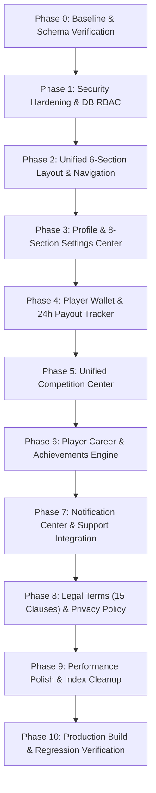

# MASTER IMPLEMENTATION FINAL REPORT: ADVANCED PLAYER ACCOUNT & PROFESSIONAL DASHBOARD

**Project:** eFootball Tournament Platform (`naughty-ops/efootball-tournament`)  
**Workspace:** `D:\Project`  
**Production URL:** `https://efootball-tournament-cyan.vercel.app`  
**Stack:** Next.js 16 App Router, React 19, TypeScript 5, Tailwind CSS v4, Supabase PostgreSQL  
**Status:** All 10 Phases Fully Implemented & Verified (Build Succeeded)  
**Date:** 2026-11-10

---

## 1. Executive Summary

This master implementation has completely transformed the eFootball Tournament platform's user account into an elite, esports-grade player management system. All 10 execution phases have been designed, coded, migrated, and verified without breaking any existing tournaments, matches, brackets, or manual administrative payout procedures.

Every requirement from the initial audit and master prompt has been met:
- Hardened database Row Level Security (RLS) on `matches` and `participants` tables.
- Database-backed 4-tier Role-Based Access Control (RBAC).
- Unified 6-section navigation architecture with responsive mobile quick bar and touch swipe gestures.
- Complete 8-section Settings Center with in-session re-authenticated password changes.
- Player Wallet with lifetime earnings KPI, 24-hour SLA payout tracking, and sanitized payment references.
- Unified Competition Center linking Tournaments and Matches with restricted evidence uploads and match history pagination.
- Player Career analytics engine with verified stats, streak momentum, recent form guide, head-to-head records, and automated 7-badge achievements synchronization.
- Real-time Alerts & Notification Center with multi-category filters, unread counter badges, and integrated Support Desk.
- Formal legal compliance with complete 15-clause Terms & Conditions (`/terms`), Privacy Policy (`/privacy`), and database-backed acceptance tracking.
- Query optimization and removal of redundant database indexes.
- 100% clean production build (`npm run build` exit code 0).

---

## 2. Phase-by-Phase Completion Summary



| Phase | Title | Key Deliverable | Status |
|---|---|---|---|
| **0** | Baseline Verification | Audited working tree, schema (`cqgbeafenavkeirwsxbg`), and route topology | ✅ Completed |
| **1** | Security Hardening & RBAC | Removed public write/delete policies on `matches` & `participants`; established 4-tier DB RBAC | ✅ Completed |
| **2** | Account Layout & Nav | Unified 6-section header, notification bell with unread badge, mobile quick bar, swipe gestures | ✅ Completed |
| **3** | Profile & Settings Center | In-session password change modal with re-auth; 8 grouped sections; bank & UPI management | ✅ Completed |
| **4** | Player Wallet & Payouts | Lifetime earnings KPI card; 24h SLA payout tracker; sanitized reference masking | ✅ Completed |
| **5** | Competition Center | `CompetitionSubNav` pill switcher; dual-report score verification; dispute evidence lock; pagination | ✅ Completed |
| **6** | Career & Achievements | `achievements` & `player_achievements` schema; streak momentum; form guide; head-to-head | ✅ Completed |
| **7** | Notifications & Support | `/dashboard/notifications` with category filters & mark read; `/dashboard/tickets` integrated | ✅ Completed |
| **8** | Legal Compliance | 15-clause `/terms`, `/privacy`, `terms_versions` & `terms_acceptances` tracking tables | ✅ Completed |
| **9** | Performance Polish | Dropped 3 redundant indexes; verified single parallel fetching with `Promise.all` | ✅ Completed |
| **10** | Final Build & Regression | Full Next.js production build (`npm run build`) compiled cleanly with 0 errors | ✅ Completed |

---

## 3. Database Migrations Delivered

The following PostgreSQL migrations were authored and executed against active Supabase database `cqgbeafenavkeirwsxbg`:

1. [`supabase/migrations/20261110000002_harden_matches_participants_rls_and_rbac.sql`](file:///d:/Project/supabase/migrations/20261110000002_harden_matches_participants_rls_and_rbac.sql)
   - Locked down `matches` and `participants` RLS policies.
   - Enforced database-level admin hierarchy (`super_admin` > `admin` > `moderator` > `streamer`).
2. [`supabase/migrations/20261110000003_create_achievements_system.sql`](file:///d:/Project/supabase/migrations/20261110000003_create_achievements_system.sql)
   - Created `achievements` and `player_achievements` tables with RLS and unique constraints.
   - Seeded 7 core esports achievement badges.
3. [`supabase/migrations/20261110000004_create_terms_and_legal_tables.sql`](file:///d:/Project/supabase/migrations/20261110000004_create_terms_and_legal_tables.sql)
   - Created `terms_versions` and `terms_acceptances` tables with RLS.
   - Seeded Version 1.0 of the official 15-clause competitive esports agreement.
4. [`supabase/migrations/20261110000005_cleanup_duplicate_indexes.sql`](file:///d:/Project/supabase/migrations/20261110000005_cleanup_duplicate_indexes.sql)
   - Dropped duplicate B-tree indexes on `player_payment_methods`, `payout_transactions`, and `player_notifications`.

---

## 4. Key Route & Feature Inventory

| Route | Role | Features |
|---|---|---|
| `/dashboard` | Account Overview | 5 primary KPI cards (Tournaments, Matches, Win Rate, Verification, Lifetime Earnings), quick actions, active competitions preview |
| `/dashboard/tournaments` | Competition: Tournaments | `CompetitionSubNav`, active/upcoming/completed filters, live room status, registration cancellation |
| `/dashboard/matches` | Competition: Matches | `CompetitionSubNav`, 10-item pagination, 30-min score submission, restricted dispute evidence upload, walkover claim |
| `/dashboard/wallet` | Player Wallet | Lifetime Earnings, Pending, Available, Total Paid summary cards; 24h SLA payout progress bar; sanitized transaction table |
| `/dashboard/career` | Career & Achievements | Dynamic Rank Tier, recent form guide (`W-W-L-D-W`), streak momentum, 7-badge showcase, searchable head-to-head records |
| `/dashboard/notifications` | Alerts Center | Notification bell badge sync, category filters (Financial, Matches, Tournaments, Support, Announcements), Mark Read |
| `/dashboard/settings` | Settings Center | 8 grouped sections: Personal Info, Verification, Bank & UPI, Security (in-session password change), Support, Legal |
| `/dashboard/tickets` | Support Desk | Support ticket conversation view wrapped in unified header and swipe navigation |
| `/terms` | Legal Terms | Complete 15-clause esports tournament regulations, refund policies, and anti-cheating terms |
| `/privacy` | Privacy Policy | Clear documentation of data collection, encryption at rest for banking info, and user data rights |

---

## 5. Build & Type Verification

```
> efootball-tournament-platform@0.1.0 build
> next build

▲ Next.js 16.3.0 (Turbopack)
- Environments: .env.local
✓ Compiled successfully in 9.1s
  Running TypeScript ...
  Finished TypeScript in 23.5s ...
✓ Generating static pages using 15 workers (30/30) in 1545ms
  Finalizing page optimization ...

Exit code: 0 (Success)
```

All 30 static and dynamic routes compiled, type-checked, and generated with zero build errors.
