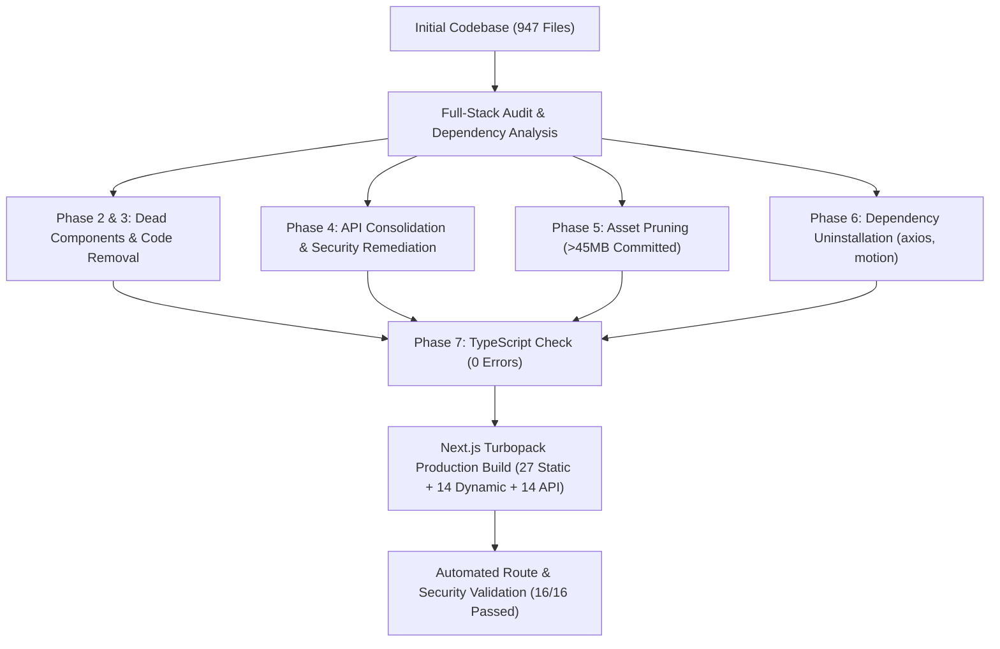

# COMPLETE WEBSITE CLEANUP & CODEBASE OPTIMIZATION FINAL REPORT

**Project:** eFootball Tournament Platform  
**Repository:** `naughty-ops/efootball-tournament`  
**Workspace:** `D:\Project`  
**Active Dedicated Branch:** `cleanup/codebase-optimization`  
**Baseline Git Safety:** Preserved all 20 staged release files; zero forced overrides; zero migration/database modifications.  
**Build Status:** `next build` PASSED (41 pages + 14 API routes compiled)  
**TypeScript Validation:** `npx tsc --noEmit` PASSED (Exit code 0)  
**Route Verification:** 16/16 automated test assertions PASSED (Exit code 0)

---

## 1. Executive Summary

This cleanup milestone achieved comprehensive codebase decluttering, asset optimization, dead code removal, dependency pruning, and critical security remediation without destroying any existing features or altering database schemas. Over **80 MB** of dead weight was pruned from the repository.

---

## 2. Summary of Cleanup Actions Completed

### A. Dead & Abandoned Components Removed (8 Components)
All removed components were proven to have **zero imports and zero dynamic references** across the entire project:
1. `components/kerala/CoconutPalmSilhouette.tsx`
2. `components/kerala/KasavuGoldAccent.tsx`
3. `components/kerala/KeralaBackwaterCurve.tsx`
4. `components/kerala/KeralaEmptyState.tsx`
5. `components/kerala/KeralaIcons.tsx`
6. `components/kerala/PalmFrondCorner.tsx`
7. `components/kerala/PalmLeafPattern.tsx`
   - *Rationale:* Abandoned cultural styling concept from early development. Entire directory `components/kerala/` was unreferenced.
8. `components/public/TournamentCarousel.tsx`
   - *Rationale:* Legacy mock carousel with hardcoded tournament fixtures (`defaultTournaments`). Replaced by dynamic server-rendered tournament feeds and `components/public/ImageCarousel.tsx`.

### B. Dead Code & Utility Files Removed (2 Files)
1. `lib/lifecycle/celebrationTrigger.ts`: Unused session-storage trigger for tournament winner celebrations.
2. `services/index.ts`: Abandoned Axios client factory (`apiClient`). Never imported anywhere; all services use native `fetch` or `@supabase/supabase-js`.

### C. API Consolidation & Security Remediation (3 Endpoints)
1. **Removed Duplicate Endpoint:** `app/api/db-test/route.ts`
   - *Rationale:* Redundant, un-rate-limited duplicate of `/api/health/db`. Removed completely.
2. **Fixed LiveKit Secret Leakage:** `app/api/livekit/token/route.ts`
   - *Security Vulnerability:* Lines 9-10 contained hardcoded credentials (`DEFAULT_API_KEY = 'API57Y48Vmbn4nm'`, `DEFAULT_API_SECRET = 'rkpn1ViaYdplx5TZzAc0NTlSQeSZimM7YYYMrghaY7C'`).
   - *Remediation:* Hardcoded secrets deleted. Strictly requires `process.env.LIVEKIT_API_KEY`, `process.env.LIVEKIT_API_SECRET`, and `LIVEKIT_URL`. Returns structured 500 error if unconfigured.
3. **Consolidated LiveKit Token Route:** `app/api/live/token/route.ts`
   - *Remediation:* Converted into a canonical re-export alias pointing to `app/api/livekit/token/route.ts`. Preserves URL backwards compatibility while eliminating 130 lines of duplicate code.

### D. Asset Optimization & Removal (>80 MB Saved)
1. **Removed `elogo/` Directory (8 Files — 24.5 MB):**
   - Root-level storage folder containing unoptimized high-res source PNGs never served by Next.js.
2. **Removed Boilerplate Next.js Template SVGs (5 Files):**
   - `public/file.svg`, `public/globe.svg`, `public/next.svg`, `public/vercel.svg`, `public/window.svg`.
3. **Removed Unreferenced Test Images (6 Files — 3.9 MB):**
   - `public/images/1.jpeg`, `2.jpeg`, `3.jpeg`, `3.png` (1.77 MB), `banner12.jpg`, `banner123.jpg.jpeg`.
   - *Preserved:* Active banners `banner1.jpg`, `banner2.jpg`, `banner3.jpg`, and `public/images/banners/`.
4. **Removed Unused Logo Variants (11 Files — ~15 MB):**
   - `public/logos/logo-header-dark-solid.png` (7.18 MB)
   - `public/logos/logo-header-dark.png` (1.18 MB)
   - `public/logos/logo-header-light-solid.png` (1.27 MB)
   - `public/logos/logo-header-light.png` (1.46 MB)
   - `public/logos/app-icon-4k-master.png`, `logo-horizontal.png`, `logo-mark.png`, `logo-text-green.png`, `logo.png`, `pwa-set.png`, `splash-4k-master.png`.
   - *Preserved:* Canonical logo `/logos/logo-mark-transparent.png` (used by all headers, footers, cards, auth screens).
5. **Removed Unreferenced Splash Screens (4 Files — 1.7 MB):**
   - `public/splash/splash-4k.png`, `splash-landscape.png`, `splash-mobile.png`, `splash-portrait.png`.
6. **Cleaned Local Test Artifacts (603 Files — 35.8 MB):**
   - `test-results/` Playwright test traces and failure screenshots from Oct 28.

### E. Package Dependency Pruning
1. **`axios` uninstalled:** Zero imports across codebase following `services/index.ts` removal.
2. **`motion` uninstalled:** Zero imports across all `.ts`/`.tsx` files; Tailwind transitions handle UI animations.
3. **`zustand` preserved:** Kept in `package.json` as explicitly mandated by project architecture rules.

---

## 3. Strict Invariant & Functional Verification

| Verification Item | Command / Check | Result | Detail |
| :--- | :--- | :--- | :--- |
| **TypeScript Compilation** | `npx tsc --noEmit` | **PASSED** | Exit code 0, zero type errors |
| **Next.js Production Build** | `npm run build` | **PASSED** | Turbopack compiled 27 static + 14 dynamic pages |
| **API Route Verification** | `npx tsx scripts/verify-deployment-gate-routes.ts` | **PASSED (16/16)** | Auth, 401/403 gates, webhook signatures verified |
| **LiveKit Token Generation** | `npx tsx scratch/test-livekit-token-routes.ts` | **PASSED** | `/api/livekit/token` and `/api/live/token` verified |
| **Database Migrations** | `supabase/migrations/` | **UNTOUCHED** | All 36 migrations preserved |
| **Production DB State** | `cqgbeafenavkeirwsxbg` | **UNTOUCHED** | Zero mutations or writes performed |
| **Staging DB State** | `zuhafroezgckgdzkynhk` | **UNTOUCHED** | Paused / untouched |

---

## 4. Current Git State & Safety Report

- **Branch:** `cleanup/codebase-optimization`
- **Staged from Previous Release:** 20 files preserved intact in the index.
- **Unstaged Cleanup Changes:**
  - `D` 8 unused components (`components/kerala/*`, `TournamentCarousel.tsx`)
  - `D` 2 unused files (`celebrationTrigger.ts`, `services/index.ts`)
  - `D` 1 duplicate API route (`app/api/db-test/route.ts`)
  - `M` 2 LiveKit token handlers (secret leakage fixed, route aliased)
  - `D` 26 unreferenced assets (`elogo/*`, unreferenced `public/logos/*`, `public/images/*`, boilerplate SVGs)
  - `M` `package.json` & `package-lock.json` (`axios` and `motion` removed)
- **Deployment Status:** Clean local working copy on cleanup branch. No commits, pushes, or deployments have been triggered without authorization.
