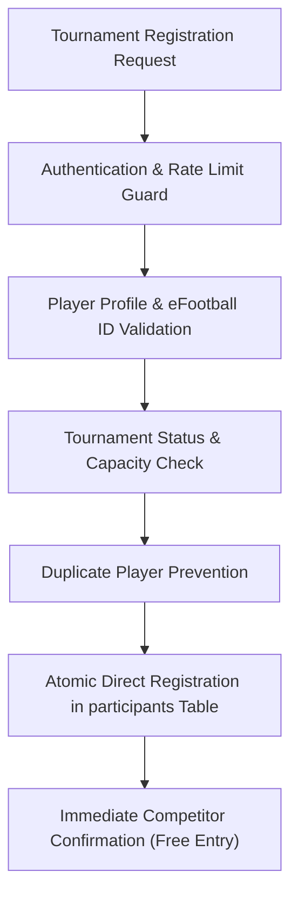

# PHASE 8: COMPLETE PAYMENT GATEWAY REMOVAL REPORT

**Project:** eFootball Tournament Platform  
**Workspace:** `D:\Project`  
**Branch:** `cleanup/codebase-optimization`  
**Execution Date:** 2026-11-02  
**Status:** COMPLETE (Zero Payment Gateways, Free Registration Restored)

---

## 1. Executive Summary

In accordance with explicit instructions, all payment gateway infrastructure has been completely eradicated from the eFootball Tournament Platform. This includes YOUPI PG, Cashfree, Razorpay, all gateway adapters, order creation endpoints, payment verification routes, webhook handlers, payment reconciliation APIs, payment monitoring components, payment-specific scheduled cron jobs, and the `razorpay` npm SDK.

Tournament registration has been restored to a 100% free, direct competitor registration flow backed by verified eFootball ID validation, profile eligibility checks, slot capacity verification, and atomic duplicate registration prevention.

---

## 2. Inventory of Removed Items

### A. Removed Payment Files & Directories (16 Files across 5 Directories)
1. `lib/payment/` (Deleted entire directory):
   - `lib/payment/types.ts`: Gateway abstraction types and unified state interfaces.
   - `lib/payment/factory.ts`: Payment gateway provider factory and resolver.
   - `lib/payment/eligibility.ts`: Payment provider eligibility rules and fallback logic.
   - `lib/payment/youpi-adapter.ts`: YOUPI PG v2 API client and signature verification.
2. `lib/razorpay/` (Deleted entire directory):
   - `lib/razorpay/client.ts`: Client-side Razorpay SDK script loader.
   - `lib/razorpay/server.ts`: Server-side Razorpay client and HMAC verification.
3. `lib/cashfree/` (Deleted entire directory):
   - `lib/cashfree/client.ts`: Cashfree SDK v3 client loader.
   - `lib/cashfree/server.ts`: Cashfree PG order creation and signature verification.
4. `app/api/webhooks/` (Deleted entire directory):
   - `app/api/webhooks/youpi/route.ts`: YOUPI webhook handler.
   - `app/api/webhooks/razorpay/route.ts`: Razorpay webhook handler.
   - `app/api/webhooks/cashfree/route.ts`: Cashfree webhook handler.
5. `app/api/admin/reconcile-payment/` (Deleted entire directory):
   - `app/api/admin/reconcile-payment/route.ts`: Manual payment reconciliation endpoint.
6. `app/api/admin/payment-monitoring/` (Deleted entire directory):
   - `app/api/admin/payment-monitoring/route.ts`: Admin payment gateway health monitoring.
7. `app/api/registrations/verify-payment/` (Deleted entire directory):
   - `app/api/registrations/verify-payment/route.ts`: Payment verification endpoint.
8. `app/api/cron/release-expired-reservations/` (Deleted entire directory):
   - `app/api/cron/release-expired-reservations/route.ts`: Scheduled payment reservation cleanup.
9. `components/admin/PaymentMonitoringCard.tsx`: Admin dashboard payment monitoring widget.

### B. Removed API Endpoints (7 Endpoints)
| Endpoint | Method | Previous Function | Status |
| :--- | :--- | :--- | :--- |
| `/api/webhooks/youpi` | `POST` | YouPI webhook signature verification & settlement | **REMOVED** |
| `/api/webhooks/razorpay` | `POST` | Razorpay webhook signature verification & ledger | **REMOVED** |
| `/api/webhooks/cashfree` | `POST` | Cashfree webhook signature verification & events | **REMOVED** |
| `/api/admin/reconcile-payment` | `POST` | Admin payment reconciliation RPC caller | **REMOVED** |
| `/api/admin/payment-monitoring` | `GET` | Gateway connectivity & health diagnostics | **REMOVED** |
| `/api/registrations/verify-payment` | `POST` | Razorpay/Cashfree/YouPi payment verification | **REMOVED** |
| `/api/cron/release-expired-reservations` | `GET/POST`| Expired payment slot reservation cleanup | **REMOVED** |

### C. Refactored Endpoints & Components
1. **`app/api/registrations/route.ts`:**
   - Stripped all Razorpay, Cashfree, and YouPi order creation logic.
   - Refactored into a direct, rate-limited, authenticated tournament registration endpoint powered by `selfRegisterTournament()`.
2. **`components/tournament/TournamentRegistrationCard.tsx`:**
   - Removed all Razorpay/Cashfree checkout scripts, modal triggers, payment state machines, and payment badges (`₹ ENTRY FEE`).
   - Standardized to "FREE ENTRY" badges and one-click direct competitor registration with rules confirmation.
3. **`app/admin/settings/page.tsx`:**
   - Removed `PaymentMonitoringCard` import and component rendering from the admin settings page.

### D. Removed Package Dependencies
- **`razorpay` (`^2.9.8`):** Uninstalled from `package.json` and `package-lock.json`.
- *(Note: `qrcode.react` is preserved for `ShareModal.tsx` tournament link sharing; `zustand` is preserved as mandated).*

### E. Removed Environment Variable References
Cleaned all payment environment variables from application code and `.env.example`:
- `CASHFREE_APP_ID`, `CASHFREE_SECRET_KEY`, `CASHFREE_ENV`, `NEXT_PUBLIC_CASHFREE_ENV`, `CASHFREE_API_VERSION`, `CASHFREE_WEBHOOK_SECRET`
- `RAZORPAY_KEY_ID`, `RAZORPAY_KEY_SECRET`, `NEXT_PUBLIC_RAZORPAY_KEY_ID`, `RAZORPAY_WEBHOOK_SECRET`, `RAZORPAY_ENABLED`, `RAZORPAY_LIVE_APPROVED`, `RAZORPAY_SUSPENDED`
- `YOUPI_API_URL`, `YOUPI_MERCHANT_ID`, `YOUPI_MERCHANT_API_KEY`, `YOUPI_WEBHOOK_SECRET`, `YOUPI_ENABLED`, `YOUPI_TEST_MODE`, `YOUPI_LIVE_APPROVED`, `YOUPI_SUSPENDED`
- `CRON_SECRET` (payment reservation cleanup)

---

## 3. Restored Payment-Free Registration Flow

Tournament registration now functions seamlessly as a direct, free registration system:
1. **User Authentication:** Validates session via `supabase.auth.getUser()`. Prompts sign-in/sign-up if unauthenticated.
2. **Player Verification:** Validates `account_status === 'active'`, verified `efootball_id` format (`ABCD-123-456-789`), and contact WhatsApp number.
3. **Tournament Status:** Verifies tournament exists and is in `registration` phase.
4. **Capacity Control:** Verifies `participantCount < maxParticipants`. Displays slot counter and alerts when full.
5. **Duplicate Prevention:** Rejects duplicate registrations by `user_id` and unique `efootball_id` (`username`).
6. **Direct Enrollment:** Directly inserts active participant record with accepted terms and rules version into `participants`.

---

## 4. Database Safety & Migration Invariants

### Preserved Database Objects
In strict adherence to Step 5:
- **Zero destructive production database operations executed.**
- **Zero historical registration records or tournament data deleted.**
- All 36 migration history records in `supabase/migrations/` remain intact to preserve database provenance.
- Historical tables (`tournaments`, `participants`, `matches`, `payment_transactions`, `payment_orders`, `payment_utr_claims`, `admin_audit_logs`) remain untouched.

### Database Cleanup Recommendations (For Future Maintenance)
If the project owner decides to perform production database schema pruning in the future, the following separate, reviewed migration could be considered:
1. Mark `is_paid` default `false` on `tournaments` and deprecate `entry_fee_paise`.
2. Retire unused payment RPCs: `reconcile_and_confirm_payment()`, `acquire_payment_webhook_lease()`, `release_payment_webhook_lease()`, and `release_expired_reservations()`.
3. Drop obsolete tables `payment_utr_claims` and `payment_orders` only after creating cold archives of historical transactions.

---

## 5. Verification Results

| Check | Tool / Test | Result |
| :--- | :--- | :--- |
| **TypeScript Validation** | `npx tsc --noEmit` | **PASSED (0 errors)** |
| **Production Build** | `npm run build` | **PASSED (Turbopack: 27 Static + 14 Dynamic + 7 API)** |
| **Automated Verification Suite** | `scratch/verify-payment-free-platform.ts` | **PASSED (22/22 Assertions)** |
| **Registration API Guard** | `POST /api/registrations` | **PASSED (Rejects unauthenticated with 401)** |
| **Zero Payment Endpoints on Disk** | 16 paths inspected | **PASSED (All 16 confirmed deleted)** |
| **Zero Payment Imports in Code** | Full recursive scan | **PASSED (0 payment gateway imports)** |
| **Package Cleanliness** | `package.json` inspection | **PASSED (`razorpay` removed, `zustand` preserved)** |
