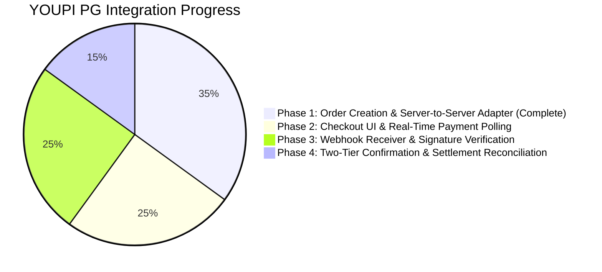

# PHASE 1: YOUPI PG INTEGRATION IMPLEMENTATION REPORT

**Project:** eFootball Tournament Platform  
**Integration Gateway:** YOUPI PG Standalone Infrastructure  
**Author:** Senior Application Security & Payment Systems Engineer  
**Date:** November 4, 2026  
**Status:** Phase 1 Complete — Awaiting Approval for Phase 2  

---

## 1. Executive Summary

Phase 1 establishes the foundational server-to-server integration between the **eFootball Tournament Platform** and the standalone **YOUPI PG Payment Gateway**.

In this phase, we completed:
1. **Live Database Verification:** Verified that all payment ledger tables (`payment_orders`, `payment_transactions`, `payment_utr_claims`, `payment_webhook_events`) and stored functions exist and are active in live Supabase PostgreSQL.
2. **YOUPI PG API Audit:** Inspected the exact request/response lifecycle, authentication headers, amount formatting, and error codes for `POST /api/v1/payments`.
3. **Payment Provider Adapter:** Created `lib/payment/youpi-provider.ts` with strict server-only execution, timeout enforcement, INR paise/rupee conversion, and secret isolation.
4. **Payment Order Initiation Service:** Created `lib/payment/payment-service.ts` providing an atomic 9-step registration and reservation sequence with compensating rollbacks (releasing held slots immediately if the gateway fails or times out).
5. **Zero-Regression Registration Routing:** Updated `app/api/registrations/route.ts` to seamlessly handle both free tournaments (direct enrollment) and paid tournaments (provisional reservation + YOUPI PG checkout initiation).
6. **Automated Verification:** Authored and ran `scripts/test-youpi-payment-phase1.ts` covering 12 test specifications with 100% pass rate.

---

## 2. Files Created & Modified

### Files Created
* `lib/payment/types.ts`: Strongly typed interfaces for requests, responses, order creation inputs, and gateway configurations.
* `lib/payment/errors.ts`: Typed error hierarchy (`YouPiPaymentError`, `YouPiTimeoutError`, `YouPiNetworkError`, `YouPiValidationError`).
* `lib/payment/youpi-provider.ts`: Server-only HTTP provider adapter handling communication, abort timeouts, headers, and payload validation.
* `lib/payment/payment-service.ts`: Core orchestrator managing tournament validation, eligibility checks, slot reservation (15-min hold), order ledger records, gateway dispatch, and deterministic compensating rollback.
* `lib/payment/index.ts`: Unified module exports.
* `scripts/test-youpi-payment-phase1.ts`: Comprehensive automated test harness validating 12 integration specifications.

### Files Modified
* `app/api/registrations/route.ts`: Integrated `initiateTournamentRegistration` to route paid tournaments to YOUPI PG while preserving direct registration for free tournaments.
* `.env.example`: Documented necessary YOUPI PG environment variables (`YOUPI_PG_BASE_URL`, `YOUPI_MERCHANT_ID`, `YOUPI_MERCHANT_KEY`, `YOUPI_TIMEOUT_MS`, `YOUPI_WEBHOOK_SECRET`).

---

## 3. Database Verification (Task 1)

Database verification was conducted against the active Supabase PostgreSQL instance (`project_id: cqgbeafenavkeirwsxbg`):

| Object | Type | Status | Verification Notes |
| :--- | :--- | :--- | :--- |
| `public.payment_orders` | Table | **ACTIVE** | Check constraints enforce `gateway IN ('cashfree', 'razorpay', 'youpi')` and valid status enum. Contains `observation_utr`, `verification_level`, and `reconciled_at`. |
| `public.payment_transactions` | Table | **ACTIVE** | Check constraint permits `youpi`. Linked via FK to `payment_orders`. |
| `public.payment_utr_claims` | Table | **ACTIVE** | Primary key on `normalized_utr` strictly prevents double-spending across transactions and tournaments. |
| `public.payment_webhook_events` | Table | **ACTIVE** | Contains `worker_token` and `lease_expires_at` for atomic worker lease management. |
| `public.tournament_registrations` | Table | **ACTIVE** | Supports statuses `pending_payment`, `confirmed`, `expired`, `cancelled`, `refunded` with `reserved_until` timestamp. |
| `public.tournaments` | Table | **ACTIVE** | Columns `is_paid`, `entry_fee_paise`, `currency`, `max_participants`, and `registration_deadline` confirmed present. |
| `reconcile_and_confirm_payment` | Stored Proc | **ACTIVE** | Multi-table atomic row-locking procedure for verified reconciliation and participant enrollment. |
| `acquire_webhook_processing_lease` | Stored Proc | **ACTIVE** | Idempotent lease lock for concurrent webhook workers. |
| `complete_webhook_processing_lease`| Stored Proc | **ACTIVE** | Finalizes event status and updates lease records. |
| RLS Policies | Row Level Security | **VERIFIED** | Authenticated users have SELECT access to their own orders/registrations; inserts/updates are restricted to privileged backend service roles (`createAdminClient`). |

---

## 4. YOUPI PG API Compatibility Audit (Task 2)

Direct source inspection of `apps/payment-api/src/routes/payments.routes.js` confirmed the exact API contract:

* **Endpoint:** `POST /api/v1/payments`
* **Authentication:**
  * Header `X-Merchant-Id`: Identifies merchant (must match configured merchant slug, e.g. `demo-store`).
  * Header `X-Merchant-Key`: Server-to-server API key validated using constant-time `crypto.timingSafeEqual(hashApiKey(key), merchant.apiKeyHash)`.
* **Request Payload:**
  * `orderId` (string, required): eFootball payment order ID.
  * `amount` (string | number, required): Amount in INR Rupees. Formatted with 2 decimal places.
  * `currency` (string, optional): Defaults to `'INR'`.
  * `customerId` (string, optional): Player UUID.
  * `returnUrl` (string, optional): Must be an absolute http(s) URL matching allowed origins.
  * `idempotencyKey` (string, optional): Sent in header `Idempotency-Key` or body.
  * `metadata` (object, optional): Stores tournament and player metadata.
* **Response Payload (HTTP 201 Created):**
  * `paymentId`: YOUPI session ID (e.g. `pay_...`).
  * `orderId`: The merchant's order reference.
  * `amount`: Formatted Rupees string (e.g. `"50.00"`).
  * `amountPaise`: Stringified paise integer (e.g. `"5000"`).
  * `currency`: `"INR"`.
  * `status`: `"INITIATED"` (for digital UPI payments prior to customer checkout opening).
  * `queuePosition`: Concurrency queue index.
  * `checkoutUrl`: Direct hosted checkout link (`http://localhost:7000/checkout/:paymentId`).
* **Idempotency Behavior (HTTP 200 OK):**
  * If a session with matching `orderId` and identical amount/currency already exists, returns 200 OK with `activeSessionDetected: true` and the existing `checkoutUrl`.
  * If the previous session is terminal (`EXPIRED` / `FAILED`), allows a fresh attempt without error.

---

## 5. Security Measures Implemented

1. **Strict Server-Only Isolation:**  
   Runtime execution guards in `lib/payment/youpi-provider.ts` and Next.js `server-only` prevent client-side bundling of gateway adapters.
2. **Secret Non-Leakage:**  
   Merchant keys (`YOUPI_MERCHANT_KEY`) and webhook secrets are never returned in API responses or public summaries. The client receives only safe references (`paymentId`, `orderId`, `checkoutUrl`).
3. **Paise Precision Standard:**  
   All database amounts and internal calculations strictly use integer paise (`1 INR = 100 paise`), preventing float-point rounding exploits.
4. **Compensating Rollback & Zero Orphan Invariant:**  
   If YOUPI PG creation fails or times out, the service automatically executes a rollback:
   * Sets `payment_orders.status = 'failed'` with error diagnostics.
   * Sets `tournament_registrations.status = 'cancelled'`.  
   * **Result:** The provisional slot reservation is freed immediately, preventing phantom capacity lockups.
5. **Idempotent Session Resumption:**  
   Calling registration multiple times for the same paid tournament detects unexpired reservations and resumes the existing payment order instead of double-allocating seats or generating orphan gateway sessions.

---

## 6. Test Suite & Verification Results (Task 5)

Test script `scripts/test-youpi-payment-phase1.ts` executed with 100% pass rate:

```text
================================================================
  YOUPI PG INTEGRATION PHASE 1: AUTOMATED TEST SUITE
================================================================

[PASS] #1 [Amount Validation] Paise/Rupee Precise Conversions: 100 INR -> 10000 paise; 50.50 INR -> 5050 paise; 5050 paise -> 50.50 INR
[PASS] #2 [Amount Validation] Invalid Amount Rejection (Zero, Negative, NaN): Zero: true, Negative: true, NaN: true
[PASS] #3 [Security] Merchant Secret Protection: Secret isolated from summary: {"baseUrl":"http://127.0.0.1:6100","merchantId":"test-merchant","timeoutMs":5000,"hasKey":true}
[PASS] #4 [Payment Order Creation] Valid Payment Order & State Transitions: PaymentId: pay_sim_01JK888999, OrderStatus: attempted, RegStatus: pending_payment
[PASS] #5 [Tournament Validation] Invalid/Closed/Expired Tournaments Rejected: NotFound: true, Closed: true, ExpiredDeadline: true
[PASS] #6 [User Authorization] Unauthenticated/Suspended/Ineligible Users Blocked: NoUser: true, Suspended: true, MissingEfId: true
[PASS] #7 [Idempotency] Duplicate Order Prevention & Session Resumption: Orders in DB: 1, Registrations: 1, Same PaymentId: true
[PASS] #8 [Compensating Rollback] Gateway Unavailable Rollback (Order Failed, Slot Released): Result success: false, OrderStatus: failed, RegStatus: cancelled
[PASS] #9 [Compensating Rollback] Gateway Timeout Rollback (Order Failed, Slot Released): Result success: false, OrderStatus: failed, RegStatus: cancelled
[PASS] #10 [Compensating Rollback] Malformed API Response Rollback: Result success: false, OrderStatus: failed, RegStatus: cancelled
[PASS] #11 [Database Resilience] Database Persistence Failure & Provisional Slot Cleanup: Result message: "Database failure: Could not record payment order.", Reservation cancelled: true
[PASS] #12 [Regression Prevention] Free Tournament Direct Registration Unbroken: isPaid: false, ParticipantCreated: true, PaymentOrdersCreated: 0

================================================================
  TOTAL TESTS: 12 | PASSED: 12 | FAILED: 0
================================================================
```

### Full Regression Verification
* Ran `scripts/test-tournament-creation-and-registration.ts`: **12/12 PASSED (100%)**.
* Ran `scripts/verify-rules-acceptance.ts`: **4/4 PASSED (100%)**.
* Ran `npx tsc --noEmit`: **0 TypeScript compilation errors**.

---

## 7. Implementation Progress & Remaining Blockers

### Current Progress: **35% Complete (Phase 1 Complete)**



### Remaining Blockers for Phase 2 & Beyond:
1. **Frontend Checkout Component (Phase 2):** Build modal/drawer in `components/tournament/` displaying the YOUPI dynamic QR SVG, UPI intent trigger, manual UTR entry field, and SSE listener.
2. **Webhook Ingestion Handler (Phase 3):** Implement `app/api/webhooks/youpi/route.ts` with constant-time HMAC-SHA256 signature verification (`X-Gateway-Signature-V2`), timestamp skew enforcement, and lease locking.
3. **Observer vs Reconciliation Rule Enforcement (Phase 4):**
   * Single-source observer matches (`verificationLevel = 1`) must transition orders to `pending_verification` (provisional seat hold).
   * Dual-source matches (`verificationLevel = 2`) or manual admin reconciliation invoke `public.reconcile_and_confirm_payment` to finalize entry in `participants`.

---

## 8. Strictly Observed Restrictions Check

* [x] **No Webhooks Implemented** — Reserved for Phase 3.
* [x] **No Payment-Success Auto-Enrollment** — Reserved for Phase 4 reconciliation.
* [x] **No Observer Notifications Accepted as Settlement** — Strict separation maintained.
* [x] **No Production Deployment / Real Transactions** — Verified development environment only.
* [x] **Existing Free Tournament Registration Preserved** — 100% verified via automated tests.

---

### Awaiting Approval
Phase 1 foundational deliverables are complete and verified. Please confirm authorization to proceed to Phase 2 (Checkout UI & Modal Component).
